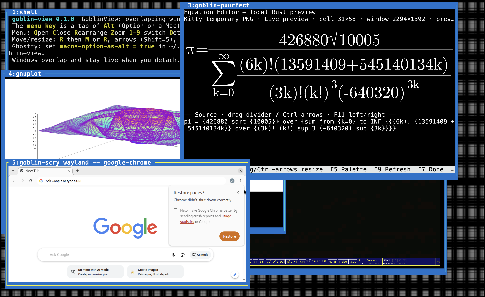

# Odin Seat

A terminal multiplexer with overlapping windows and an Alt-tap menu, not
tmux's tiled panes. Start it with `odin-seat`. It runs best in
**Ghostty**: Alt-tap via the kitty keyboard protocol, cell pixels via
XTWINOPS / mode 2048, kitty graphics on the wire. It runs anywhere a
terminal does, and so do the programs in it that draw: a picture reaches
each terminal as the best that terminal shows -- vector scenes and HDR to
Silkie, pixels to a terminal with kitty graphics (kitty, Ghostty), sixel
to one with sixel, and coloured half-block cells to one with none of
these (GNOME Terminal). See **Pictures on any terminal** below. Inner VT will be
libghostty-vt; multiplexer-side image id remap still tracks `~/dev/tmux`.

Windows overlap on a stippled backdrop, each in its own frame. Open
places a new framed window on top; selecting one raises it. Menu `R`
then `M` moves, `R` resizes, `P` `1-9` snaps, an arrow sends the window to
that half of the desktop, and the **mouse** does the
same: click to select and raise, drag the frame to move, drag the
bottom-right corner to resize, and the wheel scrolls the window under the
pointer as a native terminal would: the mouse event to an app that wants
it, arrow keys to a pager on the alternate screen, and the window's own
scrollback at a shell prompt. Each window is its own terminal emulator
whose state the server keeps, so you can **detach and reattach** like
tmux and mosh. Inner VT is a small original parser; libghostty-vt can
replace it later.

## In action

[](html/odin-seat-screenshot.png)

A working Odin Seat desktop: an equation editor renders mathematical notation,
gnuplot draws a 3D surface, and Chrome runs through `goblin-scry`, alongside a
shell. Text and graphics share the same overlapping workspace. Click the
screenshot to view it at full resolution.

## Website

The project website is [hliðskjálf.goblinreactor.com](https://xn--hliskjlf-eza0m.goblinreactor.com/).

## Install

Install on macOS or an APT-based Linux distribution with:

```sh
curl -fsSL https://xn--hliskjlf-eza0m.goblinreactor.com/install.sh | sh
```

The [installer](html/install.sh) uses Homebrew on macOS, running Homebrew's
official setup first if needed. On Linux it detects the OS codename and
architecture, checks the pinned archive key and signed repository metadata,
and configures the Goblin Reactor APT repository. Linux installation uses
`sudo` unless run as root; run the macOS installer as your regular user.
APT packages must be published for the detected release and architecture.
Other Linux distributions can use the source build below.

To download and inspect the script before running it:

```sh
curl -fsSL https://xn--hliskjlf-eza0m.goblinreactor.com/install.sh -o install-odin-seat.sh
less install-odin-seat.sh
sh install-odin-seat.sh
```

Then run `odin-seat` to start a session, or `man odin-seat` for help.
On macOS Ghostty, set `macos-option-as-alt = true` in its configuration
for the Option-tap menu; `Ctrl-\` also opens the menu.

Published builds and installation instructions are listed at
https://brew.goblinreactor.com/ for macOS and
https://apt.goblinreactor.com/ for Linux. Choose the build matching your
operating system and architecture. The package and command are `odin-seat`.

For a manual package installation, add the appropriate repository, then run:

```sh
brew install goblinreactor/tap/odin-seat  # macOS
sudo apt install odin-seat              # supported Debian-family releases
```

`packaging/debian/README.md` describes how the packages are built.

## Build

C++23, a C11 compiler for the vector rasterizer, zlib, and HarfBuzz with
`pkg-config` to find it (`libharfbuzz-dev` on Debian, `brew install
harfbuzz pkgconf` on a Mac). Host is Ghostty. Independent implementation,
with one exception written down in `docs/CLEANROOM.md`.

```
make
make test
```

The executable and package name are both `odin-seat`.
`make install` (default prefix `~/.local`) also
installs the manual pages: `man odin-seat` for the command, keys, mouse
and environment, and `man odin-seat-protocols` for what a program in a
window can use.

```
odin-seat                          # attach, creating a session if needed
odin-seat new-session -d -x 132 -y 43 -- sleep 30
odin-seat new-window -- htop        # open a window (inside a session too)
odin-seat split-window -- htop      # divide the focused window; open on the right
odin-seat split-window -v           # open below the focused window
odin-seat list-windows
odin-seat kill-server
```

`-L name` selects a socket (like tmux). `-D` keeps the server in the
foreground. `-m` (or `ODIN_SEAT_MONO=1`) paints this terminal in strict
black and white for an e-paper display: ink on paper, or reverse video
where a cell had a coloured background, with the backdrop and other
shaded areas as plain paper; other attached terminals keep their
colours. `--3d-focus=X` brings the focused window (frame, text and images)
X pixels nearer on a terminal that draws Silkie stereo depth, repainting
it as focus moves; raise Silkie's `spatial_negative_divergence` to see
anything in front of the screen.

For scripts: `send-keys [-w N] text` types into a window (C escapes
decoded, `-l` for literal), `capture-window [-w N] [-S lines|-]` prints
its text, `pipe-window [-w N] path` logs its raw output, and `menu key`
presses a menu key. `save` writes every session's windows (place, size,
title, the program's current directory and command) to
`~/.local/state/odin-seat/sessions` and `restore` recreates them.
`upgrade` replaces the running server with this program in place: the
server hands its descriptors and state to the new binary and executes it
in the same process, so windows and attached terminals carry on, screen
and scrollback included (images are redrawn by their programs). A newer
client attaching to an older server that can do this upgrades it by
itself, so after `make install` the next attach is enough.

Settings live in `~/.config/odin-seat/config`: `shell`, `scrollback`,
`download-dir`, `kitty-medium`, `term`, `backdrop`, `click-raises`,
`cell-pictures`, `mono` and `menu-key`, with `[host "name"]` sections that apply to the
terminal whose XTVERSION name matches, so an e-paper terminal can get
`mono = yes` without any flags. `csi-limit` and `escape-limit` optionally
bound one CSI sequence and one OSC, APC or DCS; `0`, the default, means no
limit. The same numbers can be set with `ODIN_SEAT_CSI_LIMIT` and
`ODIN_SEAT_ESCAPE_LIMIT`. See `odin-seat -h` and `man odin-seat`.

Detach with Menu `D`; the session and every program in it keep running.
On the way out odin-seat puts the terminal back as it found it: the
screen you had before is shown again, or, on a terminal with no
alternate screen (mosh), the screen is cleared.
Reattach by running `odin-seat` again. Several terminals can attach at
once, and each attribute of the session then goes its own way. Rows and
columns are the **smallest** of them in each dimension, as in tmux, so
every terminal shows the whole desktop and none has a part the others
cannot see; a terminal that leaves gives its rows and columns back. What a
terminal can *show* is the **most** any of them can: programs are told the
cell with the most pixels among the terminals that show pictures, the
widest gamut, the deepest channels and the greatest headroom, and each
terminal is sent what its own display takes, scaled or converted down.

Run `odin-seat` from inside a window and it talks to the current session
instead of nesting a new one, so `odin-seat new-window` or `odin-seat list-windows`
there act on the desktop you are in.

## Keys

The first window opens with a few lines of instruction painted inside
it. They are ordinary cells: the shell's prompt lands below them and
they scroll away.

The menu key is an isolated **Alt tap**: press Alt and let go with
nothing in between, and the menu opens. Alt+letter stays a chord for the
focused window. On macOS Alt is **Option (⌥)**, either side, so set
`macos-option-as-alt = true` in `~/.config/ghostty/config` for the tap
to reach odin-seat. `Ctrl-\\` is the same key for a terminal that
swallows the Alt tap. Menu `?` opens a help box with the keys, the mouse,
and this setup.

The menu key pops the menu. Then a letter: `O` open, `C` close, `Z`
zoom, `R` rearrange, `M` mark (copy mode), `T` transfer (paste the
mark), `H` hide, `S` switch (a filterable window list), `B` broadcast
typing to every window, `U` Unicode picker, `I` input method, `?` help,
`F` screen redraw, `D` detach, `Q` quit odin-seat, `1`-`9` focus that
window (a hidden one comes back), `X` select the focused window, `A`
select all or none, `L` lay the selected windows out together. The menu box spells out how to move and resize. `Q`
asks for a `y`/`n` before it closes everything. Esc or a second tap
cancels, and the letter never has to wait for the menu to be read.

Menu `E`, then `R` or `B`, splits the focused window to the right or below.
Only that window is divided; the other windows keep their places. Both halves
remain ordinary overlapping windows, and repeated splits divide the selected
half. A window too small for two frames and a content cell in each is left
unchanged. Splitting a zoomed window divides the full desktop.
The command is `split-window [-h|-v] [-s session] [-w number] [-- program ...]`:
`-h` opens on the right (the default), and `-v` opens below.

Menu `K` asks before force-killing an unresponsive window's foreground job and
shell with `SIGKILL`. Unsaved work in those programs is lost. The command
`kill-window [-s session] [-w number]` closes a window normally; add `-f` to
force-kill it without a prompt. Closing or splitting a window does not rearrange
its neighbors. Window lists, rendering and descriptor polling grow with use;
available operating-system resources determine capacity.

If the display gets garbled, tap Alt then `F` to repaint this terminal's
text and images from scratch. From a script, `odin-seat menu f` redraws
every terminal attached to the session.

Copy mode (`M`) puts a cursor in the window that moves over its screen
and scrollback with `hjkl` or the arrows, `0`/`$`, `g`/`G` and the page
keys; `v` starts a selection, `/` and `?` search (wrapping,
case-insensitive unless the pattern has a capital, `n`/`N` repeat), and
`y` copies the selection to the system clipboard and keeps it as the
mark that `T` pastes into a window. `q` leaves.

`1`-`9` select the first nine windows; the mouse selects any, and you
can open as many as you like. `docs/keys.md` has the full Odin Seat
design, most of which is not wired up yet.

Drag inside a window to select text; releasing copies it to the system
clipboard. Double-click a title bar to rename that window. Menu `I` chooses an input method (Romaji, US-International,
Pinyin, Zhuyin, Wubi) that composes CJK and accented text the same way on every
terminal.

Menu `U` opens a Unicode picker: an overlay of glyph categories you
drive with the arrows and Enter or click with the mouse. Tab (or a click
on a tab) changes category; the chosen character is typed into the
focused window.

Inline images work whenever the terminal you attach from can show one,
by **kitty graphics** or by **sixel**. Each window is its own graphics
endpoint: a program draws with either protocol, its picture is decoded to
pixels and kept as a placement floating over the window's grid, and
odin-seat re-emits that placement in whatever the host speaks. A redraw
of the text beneath leaves the picture, scrolling carries it, clearing
the screen removes it, `c=`/`r=` and the source rectangle size it, and a
delete removes it by id.

The four cases, child protocol against host protocol:

- **child kitty, host kitty** — re-emitted as kitty, placed by Unicode
  placeholder cells, so cropping, occlusion by other windows and moving
  the window are ordinary cell compositing (gnuplot's `kittycairo`, the
  Emacs previewer).
- **child kitty, host sixel** — the kitty image (usually PNG) is decoded
  and rasterised to sixel at the window's cell-grid resolution; still
  occluded per cell, since only the visible cells are drawn.
- **child sixel, host kitty** — the sixel is decoded and re-emitted as
  kitty, so it moves and clips like any kitty image.
- **child sixel, host sixel** — decoded and re-emitted as sixel,
  positioned and clipped by odin-seat.

A placeholder cell says one thing: this part of one picture, above the
text, from the cell's corner. That is all an image viewer or a previewer
asks. A program that draws as a sprite engine does asks more: pictures
*under* its text (a negative `z`), starting part way into a cell (`X`,
`Y`), or over one another, blended by their `z`. Such a window is
**layered**. A kitty-graphics terminal whose cells are the size the
programs were told is then sent what the program sent: each image once,
however many placements show parts of it, and each placement as a real
one at its cell, pixel offset, source rectangle and `z`, with the
window's text as text, so the terminal stacks and blends them as it
would without odin-seat. Each placement is cut to the cells where its
window shows. Under another window's frame, or a menu, it becomes
several placements, one for each rectangle still in view, each with the
part of the source that belongs there, so the pieces meet to the pixel;
a window that is wholly covered, hidden or set aside sends none, and
what it draws meanwhile costs the terminal nothing until it is
uncovered. Moving a sprite re-makes its placement under the same id, so
it moves without a flicker and no pixels are sent again. A terminal
whose cells are another size (two clients with different fonts) gets
the same real placements in its own pixels. Programs draw for the largest
cell attached, so such a terminal is sent each picture scaled down to its
own cell -- every pixel the mean of the area it covers -- and each
placement with its offset and source rectangle scaled to match, so a
picture covers there the cells it covers everywhere. An HDR picture
(`f=64`) is scaled in its own linear light. A vector scene has no pixels:
it goes as the same records in the smaller size, its root group scaling
everything to that, so the terminal still draws it sharp; an edit of an
element reaches every terminal as it is, and an edit of the root group
sends a terminal holding the scene scaled the whole scene again. Only a
GPU surface, which is a token and not pixels, goes as it is, placed
fitted to its cells for the terminal to scale. A
terminal that shows sixel has no placements to layer: the window's
pictures are blended into one canvas, at their pixel offsets and `z`,
and the sixels are cut from that, with a cell that has text keeping its
text.

### Pictures on any terminal

Programs are offered kitty graphics, vector scenes (`f=200`) and HDR
pixels (`f=64`) whatever is attached, and each terminal is shown them as
well as it can show anything:

| the terminal has | it is sent |
| --- | --- |
| Silkie's vector images | the scene's records; edits as edits |
| kitty graphics, no vectors (kitty, Ghostty, WezTerm) | the scene drawn here as pixels, at the size it shows it, and drawn again when the scene is edited; HDR as what eight bits show |
| sixel only (xterm, foot) | the same pixels as sixel; a layered window is flattened into one canvas first, and only the rectangles of it that changed are sent again |
| none of these (GNOME Terminal, most others) | each picture as cells: an upper half block whose foreground is the top half of the cell and whose background the bottom, text over a picture keeping its text on the picture's colour |

Scenes are drawn by Silkie's own rasterizer (`src/vector/`, see
`docs/CLEANROOM.md`), so they look as they do there. Text records (`t`)
are laid out here as Silkie lays them out, shaped by HarfBuzz, in the fonts
of the machine odin-seat's server runs on: a family this machine lacks
falls back to the font of its role (`sans`, `serif`, or a monospaced
default) rather than failing, and characters a font lacks are set in one
that has them. With no terminal attached that draws scenes itself, the
vector service (`a=v`: `fonts`, `inspect`, `upload`, `release`, `measure`)
is answered here too, from the same layout, so a program is told the size
of what will be drawn. `ODIN_SEAT_FONT_PATH`, directories separated by
colons, replaces the font directories searched. Raster images inside a
scene (`i`) are not drawn. A half-block picture is
one pixel by two to the cell: a 160 by 50 terminal shows 160 by 100.
Coarse, but a game that draws its screen is playable through it where it
could not start at all. A layered window is flattened first -- its
placements blended at their offsets and `z` into the window's pixels --
so sprites overlap and move as they should before the cells are taken
from them. `cell-pictures = no` in the config turns this off: a terminal
with no pictures is then told there are none, as before, and programs
fall back to text themselves. A strictly black-and-white client (`-m`)
is never drawn cell pictures.

A child may transmit its pixels by any kitty medium -- inline (direct),
a file, a temp file, or POSIX shared memory -- and all are accepted. What
odin-seat hands the host is the `ODIN_SEAT_KITTY_MEDIUM` tunable
(`shm`, `tempfile`, `file`, or `direct`), defaulting to shared memory so
a large image does not bloat the escape stream; set it to `direct` when
the terminal is reached across a link where a local file or shm would not
be, such as a nested ssh session.

What a program is offered is decided per session: if any attached client
can show images (by either protocol), programs may draw, and a client
whose terminal can show neither blanks the image cells. It is per client
on the paint side too, so a kitty client and a sixel client attached at
once each get the picture in their own protocol and a text client blanks
it. Detach and reattach from a different terminal and the answer follows
it. Because a sixel host is drawn at the window's cell-grid resolution,
the size we report for graphics (XTSMGRAPHICS) is that canvas, so a
program renders to what sixel will actually show rather than a larger
image that is then thrown away.

A program that sets or reads the clipboard with OSC-52 talks to the real
terminal, wrapped for an outer tmux/mosh when odin-seat is itself nested; a
read's answer comes back to the window that asked. A drag-and-drop, which the host
delivers as a bracketed paste, goes to the focused window in that window's
own paste mode (wrapped, or the bare path for a program that did not
enable bracketed paste).

Big text works too: a program that uses the OSC 66 text-sizing protocol
(`ESC ] 66 ; s=2 ; ...`) has the run laid into the window's grid at the
scaled size, the cursor advanced by the scaled width, and the run
re-emitted to a host that speaks text sizing (kitty, Ghostty), with its
fractional scale (`n`, `d`) and alignment (`v`, `h`) as the program gave
them. A host that does not gets the text unscaled, so it is never lost,
and a program detecting support by the cursor's movement sees it move. A
window keeps every run its screen and scrollback still show, however
many, and forgets those that have been drawn over.

A program that brackets its drawing in synchronized output
(`CSI ?2026h` ... `CSI ?2026l`) has each update shown as one frame: the
window is not drawn while an update is under way, and is drawn the
moment it ends, before whatever the program writes next. An update that
is never ended holds the window for 150 ms and no longer. `DECRQM`
(`CSI ? Pm $ p`) reports the modes a window keeps as set or reset, so a
program can find synchronized output (2026), pixel mouse reports (1016)
and the rest by asking.

Every window has its own screen model, and the server composes them all
onto one desktop each time anything changes: framed windows overlapping
on a backdrop in z-order, focused on top. Each attached client is then
sent only the cells that differ from what it last saw, wrapped in
synchronized output (`CSI ?2026h`/`l`), so a redraw never tears or
flashes. New windows start in the directory the client was run from —
the server daemonises into `/`, and inheriting that is not useful.

The menu is one more layer the compositor paints on top of the desktop:
a centred box when the desktop is at least `46x18`, otherwise a
reverse-video bar on the last row. Closing it just omits the layer from
the next frame, so whatever it covered comes back with no repaint dance
and no nested alternate screen. Inner windows keep running behind it and
their output lands on their own screens, not on the menu.

Ghostty reports a bare Option press/release under kitty keyboard flags
11 only when Option is Alt, so a macOS host needs this in
`~/Library/Application Support/com.mitchellh.ghostty/config.ghostty`:

```
macos-option-as-alt = true
```

`right` instead of `true` keeps left Option composing (option-e for
e-acute) at the cost of tapping only the right one. See
`docs/ghostty.md` for the host asks still outstanding.

The same commands go over the socket with no keystroke at all:

```
odin-seat -L name menu o
```

## What a program in a window can use

Each window is a terminal of its own, so the kitty protocol extensions
work per window, and whatever is best done by the real terminal is
handed to it and its answer routed back to the window that asked.

- **Keyboard**: the kitty keyboard protocol per window (`CSI > flags u`
  push, `CSI < u` pop, `CSI = flags ; mode u`, `CSI ? u`), with separate
  stacks for the main and alternate screens. The host reports every key
  as a structured event; a window that pushed flags gets it encoded for
  those flags (disambiguated escapes, key releases and repeats,
  alternate keys, all keys as escapes, associated text), and a window
  that pushed none gets what a legacy terminal sends.
- **Text**: styled and coloured underlines (`SGR 4:3`, `58`, `59`),
  independent bold/faint reset (`SGR 221`, `222`), attribute changes over
  rectangles (DECCARA, DECSACE), OSC 66 text sizing, unscroll
  (`CSI n + T`), clear-into-scrollback (`CSI 22 J`), and XTSAVE/XTRESTORE
  of private modes (`CSI ? Pm s` / `r`).
- **Silkie** (OSC 777 `caps`, `depth`, `display`, `font`, `frame`, `gesture`,
  `haptic`, `ink`, `latency`, `scroll`, `tablet-pointer`): odin-seat
  answers these itself. A selector is offered only when odin-seat can
  carry it and an attached terminal listed it. Frames have no length
  limit of their own. A contact stays with the window it started on,
  translated into that window's cells. Picture formats are whatever
  every attached terminal shares, except the formats odin-seat decodes
  itself, which are always accepted: kitty's indexed colour (`f=8`,
  `16`, in the window's colours), Silkie's packed pixels (`f=301`, `302`,
  `304`, `308` gray, `f=516` RGB565), palette images (`f=401`-`408`, with
  `a=e` palette updates) and high precision pixels (`f=316`, `632`, `664`,
  and the transfer function `E`, HDR10 included). Feature queries
  (`a=q,e=`) are answered; `S` and `O` are 64-bit and images have no size
  limit. Every picture is re-packed for each terminal's display: a 4-bit
  gray e-ink screen gets 4-bit gray, an RGB565 one 16-bit color, an HDR
  one half floats, never more than it can show; then the narrowest exact
  format it listed, deflated when smaller. The display is asked again on every resize. `goblin-pointer`
  and `goblin-download` are unchanged.
- **Silkie fonts** (`font.1`, SGR 10-19): role, weight and slant are kept
  with each cell through scrollback, resizing and a live upgrade, and are
  painted to the terminals that listed `font.1`; others see ordinary text.
- **Silkie stereo depth** (`depth.1`): disparity in millidegrees or
  reference pixels plus vertical phase, kept with each cell like a font
  style (scrollback, resizing, saved cursor, live upgrade) and reset by
  SGR 0, RIS and the shell-prompt mark. Painted to terminals that listed
  `depth.1`, so text and images stand out of or sink into the screen on
  stereo displays; flat elsewhere. Image placements are made at the depth
  in effect when placed; vector scenes carry their own `depth=` keys.
- **Silkie vector images** (`f=200`, including shaped text, box clips and
  HDR and wide gamut paints, which pass through unread): a scene is kept
  as its table of records, so an edit (`a=e`) reaches the terminal without
  sending the scene again and a terminal that attaches later is sent it as
  it stands. Strokes a terminal inks for itself go into the table from its
  reports, and on to any other terminal attached. A terminal only inks
  through the cells it was sent, so ink stays in its window, and a stroke's
  reports are mapped so the program's numbers match the terminal's. Each
  terminal's brush follows its pen, to any window and placement, under ids
  of our own, so programs' ids never clash; a stroke's element takes the
  program's id when it ends. The vector service (`a=v`: fonts, inspect, measure, upload, release) is
  answered by one terminal and routed back. Each window has its own
  namespace of session fonts, and a font stays as long as a scene uses it,
  since every terminal shapes the scene for itself.
- **Image pointers** (OSC 22 `image:<id>:<x>:<y>`): resolved among the
  window's images, so a window's image `9` is not another window's, with
  the shape below on the stack showing while the image is missing.
- **Mouse**: pixel-position reporting (mode 1016), keeping the host's
  position inside the cell, with kitty's leave event (button 288) when
  the pointer moves off the window; hover motion for windows in mode
  1003; pointer shapes (OSC 22) kept as a stack per window and shown by
  the host for the window under the pointer.
- **Colours**: OSC 4, 10, 11, 12, 21 (kitty colour control) and the
  push/pop of OSC 30001/30101 (as deep as the program pushes) change only
  that window: the compositor
  remaps its cells, so two windows can redefine the palette differently
  and the host's own palette is never touched. Queries are answered from
  the window's state; the cursor colour is applied to the host for the
  focused window.
- **Program status**: OSC 7501 records are kept per window under the
  protocol's lifetime rules, with no size limits. A framed window shows its
  most urgent record after its title (percentage or `⋯` working, `✓` done,
  `✗` failed, black on yellow when blocked on you, `×N` for several) and its
  message along the bottom border. A terminal that answers `OSC 7501 ; ?`
  also gets every window's records as `w<id>/<id>`, plus a root record for
  the most urgent of them.
- **Deep colours**: Silkie's `38:0:id:r:g:b` (and 48, 58) keep sixteen bits a
  channel in the cell, exactly, and reach a terminal that lists `deep` in
  its `sgr` capability field; others get the nearest eight-bit colour.
- **Clipboard and notifications**: OSC 52 and kitty's OSC 5522 go to the
  terminal. Desktop notifications (OSC 99) return to their originating window;
  OSC 9 and OSC 777 `notify` are converted to clickable OSC 99 notices;
  ConEmu's numbered OSC 9 sub-commands set the title (3), report progress
  (4, as program status, never a notice), record the working directory (9,
  like OSC 7) and mark a prompt (12). Each
  layer appends `odin-seat/<session-token>/<window-id>` in `r`, with commas
  between hops; Silkie returns the full path and requested actions. Clicks
  restore nested windows outside-in. Report-only notices preserve focus,
  stale clicks are discarded, and converted notices consume their final reply.
  Routing survives live server upgrades without a bounded pending-notice table.
  DECSET 1004 focus reports follow the active pane and host terminal. Codex can
  use `[tui] notifications = true`, `notification_method = "osc9"`, and
  `notification_condition = "unfocused"` in `~/.codex/config.toml` (as three
  separate settings under `[tui]`).
- **Extra cursors** (kitty multiple cursors, `CSI > shape ; type : coords
  SP q`, queries `100`, `101`): a host that draws them is sent the set
  translated to the desktop; one that cannot sees them painted as
  reverse video or underline.
- **Drag and drop** (OSC 72): the drop lands on the window and cell it
  was dropped into. A program that said it takes drops (`t=a`) gets the
  protocol translated into its own cells and its answers relayed;
  otherwise odin-seat accepts on the window's behalf, fetches the
  files' paths or the text, and pastes them into that window (bracketed
  when the program asked for it). A terminal that sends drops as a
  bracketed paste still gets the paste routed to the focused window.
- **File transfer**: kitty's protocol (OSC 5113) in both directions and
  goblin-mosh's background download (OSC 777 `goblin-download`). When
  the terminal you attach from speaks the protocol -- kitty for 5113,
  goblin-mosh for 777, known by their XTVERSION names -- the request is
  handed to it. Otherwise the buck stops here: a box asks whether to save
  into your downloads directory (`$ODIN_SEAT_DOWNLOAD_DIR`,
  `$XDG_DOWNLOAD_DIR`, or `~/Downloads`), or whether a program may read
  the files it named; files are staged, their sizes verified, published
  without overwriting (`report.pdf`, then `report.pdf.1`), never opened
  or run, and the program is answered in its own protocol. A pasted "y"
  cannot approve anything.
- **Queries**: XTVERSION names the multiplexer; XTGETTCAP answers the
  capabilities a program can count on (`TN`, `Tc`, `RGB`, `Su`, `colors`,
  `setrgbf`/`setrgbb`, `Smulx`, `Setulc`, `Ms`) and says so for the rest.

`odin-seat list-clients` shows what each attached terminal is
(its XTVERSION name) and what it can do.

## License

Odin Seat is licensed under the Apache License, Version 2.0 (`LICENSE`,
`NOTICE`). The bundled input-method dictionaries are generated from
MIT-, Apache-2.0- and Unicode-licensed data; `share/README.md` records
their provenance.

## Tracking tmux

Kitty protocol work lives in Adam's tmux `kitty-graphics` branch. Pin and
diff:

```
tools/track-tmux          # fail if ~/dev/tmux moved
tools/track-tmux pin      # after a deliberate port
```

See `docs/tmux-tracking.md`. Ported code belongs in `src/tmuxport/` only.


### Pen, fingers and cell-tiled drawing

Applications opt into [Goblin pointer v1](docs/GOBLIN_POINTER_PROTOCOL.md) independently
in each window. Odin Seat translates content coordinates for the desktop viewport,
window frame and content offset, preserving fractional pixels, pressure, tilt,
barrel rotation when supplied, eraser identity and touch contacts. A contact remains
captured by its original window through release, even if it crosses another window.
Two-finger gestures require both contacts to belong to the same window. Resize,
disconnect, reset and application mode changes cancel unfinished contacts.
Applications using ordinary mouse tracking receive translated pen/finger events.

Kitty image storage, placements, and client display caches use dynamic hash maps,
with no fixed image-count or memory budget. Image pixel buffers grow dynamically,
including images read from files or shared memory. This supports Inkline's Goblin
Draw client, which uses one image per character cell and
updates only cells touched by a stroke. Window clipping still uses Kitty Unicode
placeholders; the updated Inkline renderer supports them. Client/server protocol 5
adds pointer capability metadata; rebuild both sides together. The explicit
`upgrade` command preserves per-window input modes.

### SSH agent forwarding across reconnects

New windows receive a stable session `SSH_AUTH_SOCK`. Requests follow the most
recently attached terminal, independent of pane focus; disconnecting it selects
the previous attached terminal. Existing connections fail on a provider change
and new connections use the new keys. The socket and selection survive a live
server upgrade. For a shell started before this feature, run
`export SSH_AUTH_SOCK="$(odin-seat agent-socket)"` once (`-s NAME` selects a session).

`odin-seat -A attach` explicitly allows the client's local `SSH_AUTH_SOCK` as
a fallback, so a fresh SSH-forwarded agent can be used on a terminal without
this extension. Enable `ssh_agent_forwarding yes` in Silkie for a native
provider. Requests and replies route through
nested Odin Seat and Skiff sessions, with scoped IDs and persistent backend
connections that preserve OpenSSH session bindings. See
[the protocol and permissions](docs/SSH_AGENT_PROTOCOL.md).
